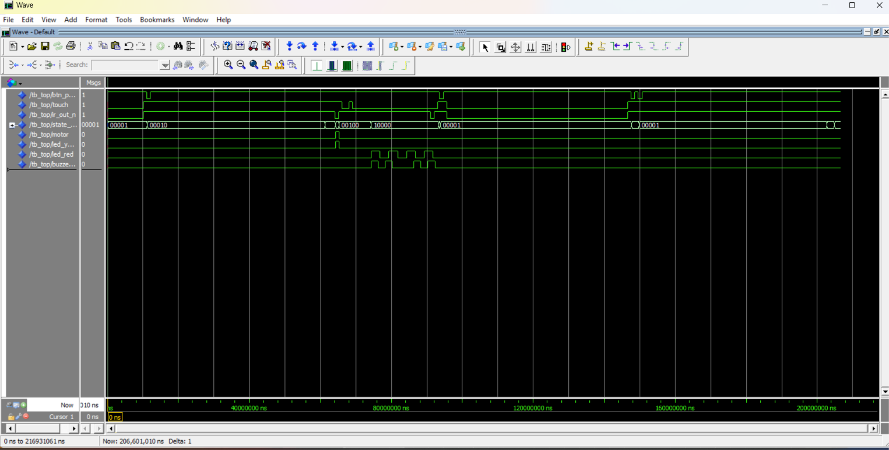

# Smart Blind Stick (FPGA / VHDL)

A walking stick for blind users, built on an Intel **DE10-Lite** FPGA board and written entirely in **VHDL**.

- An **IR sensor** detects obstacles ahead and a **vibration motor** warns the user.
- A **touch sensor** on the handle detects when the stick is dropped and a **buzzer** beeps so it can be found again.
- A **push button** turns the stick on and off, and the board's 7-segment displays show what the stick is doing.

Demo video: [`docs/demo.mp4`](docs/demo.mp4)

---

## How it behaves

| State    | Display  | What happens                                                        |
|----------|----------|---------------------------------------------------------------------|
| OFF      | blank    | Nothing happens until the button is pressed                         |
| ON       | `ON`     | Shown for 5 s after switching on                                    |
| NORMAL   | `NOrnAL` | Hand on the handle, no obstacle                                     |
| ALERT    | `ALErt`  | IR sensor sees an obstacle: motor vibrates, green LED on            |
| DROP     | `drOP`   | Hand off the handle for 0.5 s: yellow LED blinks, buzzer beeps      |
| OFF msg  | `OFF`    | Shown for 5 s after switching off, then blank                       |

- Pressing the button in any "on" state turns the stick off.
- Priority while on: **DROP > ALERT > NORMAL**. The motor only runs in ALERT; the buzzer only sounds in DROP.
- Touching the handle again in DROP goes straight back to NORMAL.

---

## Design

Every input passes through a synchroniser and debounce filter before reaching the state machine; the state machine alone decides the outputs.

| File                       | Purpose                                                                 |
|----------------------------|-------------------------------------------------------------------------|
| `src/top.vhd`              | Top level: connects every module to the board pins                       |
| `src/controller.vhd`       | Main state machine (OFF, ON, NORMAL, ALERT, DROP, OFF msg)              |
| `src/tick_gen.vhd`         | Makes 1 µs and 1 ms ticks from the 50 MHz clock                          |
| `src/input_filter.vhd`     | 2-flip-flop synchroniser + 20 ms debounce for every external input       |
| `src/drop_detect.vhd`      | Reports "dropped" once the handle has been released for 500 ms           |
| `src/blinker.vhd`          | Blinks the DROP LED                                                      |
| `src/buzzer.vhd`           | Beep pattern and 2 kHz tone for the buzzer                               |
| `src/seg7_msg.vhd`         | Writes `ON`, `OFF`, `ALErt`, `drOP`, `NOrnAL` on the six 7-segment digits |
| `src/stick_pkg.vhd`        | Shared constants (message codes)                                         |
| `sim/tb_top.vhd`           | Self-checking testbench that runs the whole scenario                     |
| `constraints/pins.tcl`     | Quartus pin assignments for the DE10-Lite                                |

Timing values (5 s messages, 500 ms drop delay, 20 ms debounce) are VHDL **generics**, so the testbench can shrink time and simulate the full scenario in milliseconds.

---

## Hardware

**Parts**
- Terasic DE10-Lite (MAX 10, 10M50DAF484C7G)
- KY-032 IR obstacle sensor (OUT goes LOW when an obstacle is detected)
- TTP223 capacitive touch sensor (I/O goes HIGH when touched)
- Coin vibration motor driven by a 2N2222A NPN transistor (1 kΩ base resistor), with a 1N4001 flyback diode and a 100 nF capacitor across the motor
- HW-508 buzzer module
- Yellow and green LEDs, each with a 330 Ω resistor
- Push button, breadboard, jumper wires

**GPIO header (JP1) wiring**

| Header pin | Signal in `top.vhd` | Connected to                                   |
|-----------:|---------------------|------------------------------------------------|
| 1          | `ir_out_n`          | IR sensor OUT                                  |
| 3          | `motor`             | Transistor base (through 1 kΩ)                 |
| 4          | `led_red`           | Yellow LED (DROP warning, blinks)              |
| 5          | `led_yellow`        | Green LED (ALERT warning)                      |
| 19         | `touch`             | Touch sensor I/O                               |
| 33         | `buzzer_pwr`        | Buzzer +                                       |
| 39         | `buzzer_s`          | Buzzer S (tone)                                |
| 40         | `btn_power_n`       | Push button to GND (FPGA internal pull-up)     |
| 12         | —                   | GND                                            |
| 29         | —                   | 3.3 V                                          |

> The signal names `led_red` / `led_yellow` come from an earlier version that used red and yellow LEDs. The final build uses a yellow LED on pin 4 and a green LED on pin 5; the logic is the same.

On the board itself: **KEY1** is reset, **KEY0** is a second ON/OFF button, **LEDR0-4** show the current state and **LEDR5-9** show what the FPGA sees on each input (handy for debugging the wiring).

**Lessons from the hardware**
- Motor noise was falsely triggering the touch sensor (ALERT jumping to DROP). A 100 nF capacitor across the motor fixed it.
- A flyback diode in the wrong direction kept the motor running permanently: the stripe must face the 3.3 V side.
- The buzzer's S pin must be held LOW when silent, otherwise it keeps buzzing.

---

## Simulate (ModelSim)

1. Create a project and add every file in `src/` and `sim/`.
2. **Compile → Compile Order → Auto Generate**.
3. In the transcript:
   ```
   vsim -t ns work.tb_top
   add wave /tb_top/*
   run -all
   ```
4. The run ends with `SIMULATION FINISHED - all checks done`.



## Build and program (Quartus Prime Lite)

1. New project, device **10M50DAF484C7G**, add every file in `src/`.
2. Set `top` as the top-level entity.
3. **Tools → Tcl Scripts → `constraints/pins.tcl` → Run**.
4. **Processing → Start Compilation**.
5. **Tools → Programmer**: program the `.sof` to test, or convert to a `.pof` and program the flash (CFM0) so the design stays on the board after power-off.

---

Full write-up: [`docs/Report.pdf`](docs/Report.pdf)
